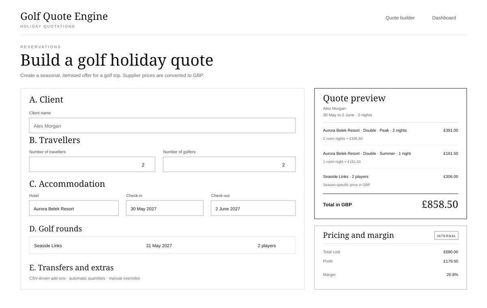

# Golf Quote Engine

Golf Quote Engine is a static quoting and pro forma invoicing app for a golf holiday company. It helps a sales agent price a stay night by night, add player-based golf and extras, choose suitable transfer vehicles, review the internal margin, save the quote, and produce a client-ready PDF.

**Live site:** [https://nils-101.github.io/GOLF-engine/](https://nils-101.github.io/GOLF-engine/)

**Local site:** serve the repository root over HTTP, then open `index.html`. For example, `ruby -run -e httpd . -p 8000`.

## Using the app

1. Open the quote builder and enter the client, traveller, hotel, and travel details.
2. Add one or more room lines. Room choices follow the selected hotel; occupancy and board basis come from the hotel price list.
3. Add golf rounds, transfers, and extras. The “Fill full days” helper adds one round for every full day between arrival and departure.
4. Review the live quote and the separate **Internal** cost and margin panel. Resolve any errors before saving or downloading an invoice.
5. Save a quote to this browser, or download its pro forma invoice. Open **Dashboard** to search, update status, duplicate, export, or back up saved quotes.

The dashboard stores quotes in the current browser's local storage, not on a server. Use the JSON backup regularly to move or preserve quote records. The quote builder, dashboard, and automated tests are available from the header and `tests.html`.

## How pricing works

The app reads the CSV files in `data/` on each page load. Each hotel night and golf round uses the season that contains its date. Hotel prices are per room per night; golf prices are per player per round; transfer prices are per vehicle for one one-way leg. Extras derive their default quantities from their unit, and each can be overridden.

Prices are parsed into integer minor units. Each complete supplier line is converted to GBP using the matching `fx.csv` rate and rounded half up to a penny. Totals sum those already-rounded lines. Valid offers are shown as separate discount lines. Deposit, balance, quote expiry, and balance due date use the values in `settings.csv`.

The pro forma PDF repeats the on-screen quote lines and GBP amounts, with costs and margins excluded. Company, address, contact, bank, and terms are read from `data/settings.csv`; invoice numbers are sequential per browser and issue year. The root `logo.png` is used as the invoice logo. The embedded Great Vibes signature font is distributed under the Open Font License in `fonts/OFL-Great-Vibes.txt`.

## Tests

- Node: `npm test`
- Browser: serve the repository root and open `tests.html`, then select **Run all tests**.

The automated suite covers calendar dates, currency rounding, CSV parsing and validation, exact seasonal sample prices, capacity rules, transfers, extras, and each offer type.

## Hosting and technology

This repository is designed for GitHub Pages' static hosting. Publish the repository root from the `main` branch; there is no application server, build step, bundler, or runtime framework. The application uses HTML, CSS, native JavaScript ES modules, CSV files, browser local storage, and pinned jsPDF 2.5.1 / jsPDF-AutoTable 3.8.2 CDN scripts for PDF downloads.

The company identity and banking data in the sample are placeholders. Replace them and the fictional sample rates before using this app for real bookings.